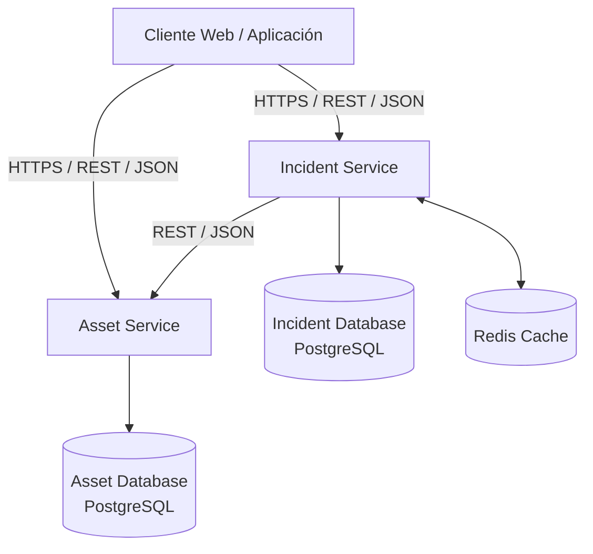

# CloudMaint

**Plataforma Cloud-Native para la gestión inteligente de incidencias y mantenimiento de instalaciones técnicas**

Proyecto desarrollado para la asignatura **Cloud Computing: Fundamentos e Infraestructuras** del Máster Universitario en Ingeniería Informática de la Universidad de Granada.

## Documentación

La memoria completa correspondiente al Hito I se encuentra disponible en:

[Memoria Hito I - CloudMaint](docs/Hito1.pdf)

---

## 1. Descripción del dominio

CloudMaint es una aplicación Cloud-Native orientada a organizaciones que gestionan instalaciones y activos técnicos, como instalaciones eléctricas, climatización, protección contra incendios, instalaciones fotovoltaicas, sistemas de bombeo o equipamiento industrial.

El sistema pretende mejorar la gestión de incidencias de mantenimiento, evitando que su prioridad dependa únicamente del orden de llegada o de una valoración subjetiva realizada por el usuario.

CloudMaint determina automáticamente la prioridad de intervención a partir de dos conceptos:

- **Criticidad del activo:** importancia que tiene el activo para la organización.
- **Gravedad de la incidencia:** grado de afectación producido por una avería concreta.

La lógica principal del sistema es:

```text
Criticidad del activo
        +
Gravedad de la incidencia
        ↓
Prioridad de intervención
        ↓
SLA
```

El **SLA (Service Level Agreement)** establece el tiempo máximo previsto para resolver la incidencia.

La descripción detallada de los criterios de cálculo se encuentra en la memoria del Hito I.

---

## 2. Casos de uso principales

Los principales casos de uso previstos son:

- Registrar y consultar activos técnicos.
- Registrar incidencias asociadas a un activo.
- Calcular automáticamente la gravedad de una incidencia.
- Consultar la criticidad del activo afectado.
- Calcular automáticamente la prioridad de intervención.
- Asignar un SLA a cada incidencia.
- Modificar el estado de una incidencia.
- Consultar incidencias críticas.
- Detectar incidencias próximas a incumplir su SLA.
- Consultar incidencias cuyo SLA haya sido incumplido.

---

## 3. Arquitectura de referencia

CloudMaint utiliza una arquitectura distribuida basada inicialmente en dos microservicios independientes:

- **Asset Service**
- **Incident Service**

Cada microservicio posee una responsabilidad de negocio claramente definida y es propietario de sus propios datos.



### Asset Service

Responsable de gestionar los activos técnicos.

Funciones principales:

- registrar activos;
- consultar activos;
- modificar sus datos;
- almacenar su tipo, ubicación, estado y criticidad;
- proporcionar información a otros servicios.

### Incident Service

Responsable de gestionar las incidencias y la principal lógica de negocio.

Funciones principales:

- registrar incidencias;
- calcular la gravedad;
- obtener la criticidad del activo;
- calcular la prioridad;
- asignar el SLA;
- calcular la fecha límite de resolución;
- gestionar el estado de las incidencias;
- detectar incidencias críticas o con riesgo de incumplimiento del SLA.

### Persistencia

Se utilizará **PostgreSQL** como sistema de persistencia.

Cada microservicio será propietario de sus datos:

```text
Asset Service
    └── asset_db

Incident Service
    └── incident_db
```

Un microservicio no accederá directamente a las tablas del otro.

La comunicación entre servicios se realizará mediante APIs REST.

### Caché

Se utilizará **Redis** para almacenar temporalmente información de activos consultada frecuentemente por `Incident Service`, especialmente su criticidad.

---

## 4. API REST

### Asset Service

| Método | Endpoint | Descripción |
|---|---|---|
| `POST` | `/api/assets` | Registrar un activo |
| `GET` | `/api/assets` | Obtener los activos |
| `GET` | `/api/assets/{id}` | Obtener un activo |
| `PUT` | `/api/assets/{id}` | Modificar un activo |

Ejemplo:

```json
{
  "id": 17,
  "name": "Bomba PCI Nave A",
  "type": "FIRE_PROTECTION",
  "location": "Nave A",
  "criticality": "CRITICAL",
  "status": "ACTIVE"
}
```

### Incident Service

| Método | Endpoint | Descripción |
|---|---|---|
| `POST` | `/api/incidents` | Registrar una incidencia |
| `GET` | `/api/incidents` | Obtener incidencias |
| `GET` | `/api/incidents/{id}` | Obtener una incidencia |
| `PATCH` | `/api/incidents/{id}/status` | Modificar su estado |
| `GET` | `/api/incidents/critical` | Obtener incidencias críticas |
| `GET` | `/api/incidents/sla-risk` | Consultar incidencias próximas al SLA |
| `GET` | `/api/incidents/sla-breached` | Consultar incidencias con SLA incumplido |

Ejemplo de creación de incidencia:

```json
{
  "assetId": 17,
  "description": "La bomba presenta fuertes vibraciones",
  "serviceImpact": "DEGRADED",
  "safetyImpact": "POTENTIAL_RISK",
  "workaround": "NONE"
}
```

Ejemplo de respuesta:

```json
{
  "id": 101,
  "assetId": 17,
  "severity": "HIGH",
  "priority": "CRITICAL",
  "status": "OPEN",
  "slaHours": 2,
  "deadline": "2026-10-20T18:00:00"
}
```

---

## 5. Justificación Cloud según NIST SP 800-145

CloudMaint se diseña para aprovechar las cinco características esenciales de la computación en la nube definidas por NIST.

### Autoservicio bajo demanda

Los recursos necesarios para ejecutar la aplicación podrán aprovisionarse y modificarse automáticamente según las necesidades del sistema.

### Acceso amplio a la red

Las funcionalidades estarán disponibles mediante APIs REST utilizando HTTP/HTTPS, permitiendo el acceso desde aplicaciones web, móviles u otros sistemas.

### Agrupación común de recursos

Los recursos de procesamiento, almacenamiento y red serán proporcionados por infraestructura cloud compartida y virtualizada.

### Elasticidad rápida

Los microservicios podrán escalar de forma independiente.

Por ejemplo, un incremento puntual del número de incidencias podría requerir aumentar las instancias de `Incident Service` sin necesidad de escalar `Asset Service` en la misma proporción.

### Servicio medido

Podrán monitorizarse recursos como:

- CPU;
- memoria;
- almacenamiento;
- tráfico de red;
- número de peticiones;
- número de instancias desplegadas.

Esto permitirá relacionar el consumo de recursos con el coste operativo.

---

## 6. Actores según NIST SP 500-292

### Cloud Consumer

La empresa u organización que utiliza CloudMaint para gestionar sus activos e incidencias.

**Impacto económico:** reduce la necesidad de realizar una elevada inversión inicial en infraestructura propia y permite adaptar el gasto a los servicios utilizados.

### Cloud Provider

Proveedor encargado de suministrar la infraestructura cloud necesaria para ejecutar CloudMaint.

El proveedor concreto se determinará en posteriores hitos.

**Impacto económico:** factura los recursos utilizados, como procesamiento, almacenamiento o transferencia de datos.

### Cloud Broker

Intermediario que puede facilitar la contratación, integración o gestión de servicios de diferentes proveedores cloud.

CloudMaint no necesita obligatoriamente un broker en su primera versión.

**Impacto económico:** puede introducir un coste adicional, aunque también puede facilitar la optimización de recursos y proveedores.

### Cloud Auditor

Entidad responsable de evaluar de forma independiente aspectos relacionados con seguridad, cumplimiento, rendimiento y configuración.

**Impacto económico:** las auditorías introducen un coste, pero reducen riesgos técnicos, económicos y regulatorios.

### Cloud Carrier

Proveedor responsable de proporcionar la conectividad entre el consumidor y los servicios desplegados en la nube.

**Impacto económico:** la calidad y coste de la conectividad forman parte del coste global de utilización del servicio.

---

## 7. Tecnologías previstas

| Tecnología | Utilización |
|---|---|
| Java 21 | Lenguaje principal |
| Spring Boot | Desarrollo de microservicios |
| Spring Web | APIs REST |
| Spring Data JPA | Persistencia |
| PostgreSQL | Base de datos |
| Redis | Caché |
| Maven | Gestión de dependencias |
| Docker | Contenerización |
| Docker Compose | Entorno local |
| GitHub | Repositorio y gestión |
| GitHub Actions | Integración continua |

En posteriores hitos podrán incorporarse tecnologías como Terraform, Kubernetes, Prometheus y Grafana.

---

## 8. Gestión del desarrollo

La rama principal del proyecto será:

```text
main
```

Las nuevas funcionalidades se desarrollarán mediante ramas independientes:

```text
feature/asset-service
feature/create-incident
feature/severity-calculation
feature/priority-calculation
feature/sla
```

La integración se realizará mediante Pull Requests.

Se utilizarán commits semánticos:

```text
feat: nueva funcionalidad
fix: corrección de errores
docs: documentación
refactor: refactorización
test: pruebas
```

Las historias de usuario se gestionarán mediante GitHub Issues y seguirán el formato:

```text
Como [rol],
quiero [acción],
para [beneficio].
```

Cada historia incluirá:

- criterios de aceptación;
- etiqueta `user-story`;
- checklist de tareas técnicas;
- Milestone correspondiente.

---

## 9. Estructura del repositorio

```text
cloudmaint/
│
├── asset-service/
├── incident-service/
│
├── docs/
│   └── Hito1.pdf
│
├── .github/
│   ├── ISSUE_TEMPLATE/
│   │   └── user_story.md
│   │
│   └── PULL_REQUEST_TEMPLATE.md
│
├── .gitignore
├── docker-compose.yml
└── README.md
```
