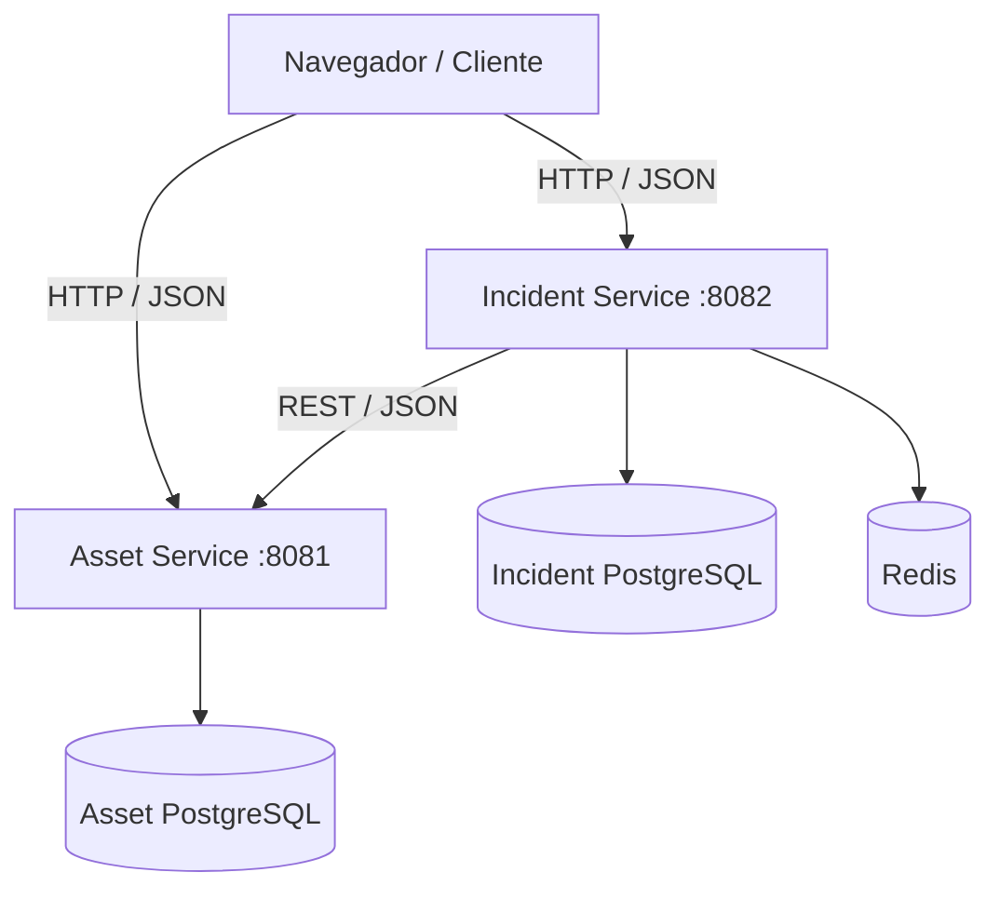

# CloudMaint

**Plataforma Cloud-Native para la gestión inteligente de incidencias y mantenimiento de instalaciones técnicas**

Proyecto desarrollado para la asignatura **Cloud Computing: Fundamentos e Infraestructuras** del Máster Universitario en Ingeniería Informática de la Universidad de Granada.

---

## 1. Descripción del dominio

CloudMaint es una aplicación Cloud-Native orientada a organizaciones que gestionan instalaciones y activos técnicos, como instalaciones eléctricas, climatización, protección contra incendios, instalaciones fotovoltaicas, sistemas de bombeo o equipamiento industrial.

El sistema pretende mejorar la gestión de incidencias de mantenimiento evitando que su prioridad dependa únicamente del orden de llegada o de una valoración subjetiva realizada por el usuario.

CloudMaint diferencia entre:

- **Criticidad del activo:** importancia que tiene el activo para la organización y que es definida por el responsable que registra dicho activo.
- **Gravedad de la incidencia:** grado de afectación producido por una avería concreta y calculado automáticamente por el sistema.

La lógica principal es:

```text
Criticidad del activo
        +
Gravedad de la incidencia
        ↓
Prioridad de intervención
        ↓
SLA
        ↓
Fecha límite
        ↓
Evaluación del cumplimiento
```

El **SLA (Service Level Agreement)** establece el tiempo máximo previsto para resolver una incidencia.

Cuando una incidencia es resuelta, CloudMaint compara automáticamente la fecha real de resolución con la fecha límite y determina si el SLA ha sido cumplido.

---

## 2. Estado actual del proyecto

En el **Hito 2** se ha desarrollado y desplegado localmente una primera versión funcional de CloudMaint formada por dos microservicios independientes:

- `asset-service`
- `incident-service`

El sistema permite actualmente:

- registrar y consultar activos técnicos;
- modificar los datos de un activo;
- registrar incidencias asociadas a activos existentes;
- calcular automáticamente la gravedad de una incidencia;
- obtener la criticidad del activo mediante comunicación entre microservicios;
- calcular automáticamente la prioridad;
- asignar automáticamente un SLA;
- calcular la fecha límite de resolución;
- actualizar el estado de una incidencia;
- registrar automáticamente su fecha de resolución;
- evaluar automáticamente el cumplimiento del SLA;
- ejecutar todo el sistema mediante Docker Compose;
- validar el proyecto mediante integración continua con GitHub Actions;
- construir y publicar imágenes de los microservicios en GitHub Container Registry.

Adicionalmente, se ha incorporado una interfaz web sencilla para facilitar la demostración del funcionamiento del sistema.

---

## 3. Arquitectura

CloudMaint utiliza una arquitectura distribuida basada en dos microservicios independientes.



### Asset Service

Responsable de gestionar los activos técnicos.

Funciones principales:

- registrar activos;
- consultar activos;
- modificar sus datos;
- almacenar tipo, ubicación, estado y criticidad;
- proporcionar información de los activos a otros servicios.

### Incident Service

Responsable de gestionar las incidencias y la principal lógica de negocio.

Funciones principales:

- registrar incidencias;
- calcular la gravedad;
- consultar la criticidad del activo mediante `Asset Service`;
- calcular la prioridad;
- asignar el SLA;
- calcular la fecha límite;
- gestionar el estado de las incidencias;
- registrar la fecha de resolución;
- evaluar el cumplimiento del SLA.

### Persistencia

Cada microservicio es propietario de su propia base de datos PostgreSQL:

```text
Asset Service
    └── assetdb

Incident Service
    └── incidentdb
```

Un microservicio no accede directamente a las tablas del otro.

La comunicación entre servicios se realiza mediante APIs REST.

### Redis

El entorno local incluye una instancia de **Redis** asociada a `Incident Service`.

Redis queda disponible como infraestructura para incorporar mecanismos de caché y optimización en posteriores iteraciones del proyecto.

---

## 4. Lógica de negocio

### Gravedad de una incidencia

La gravedad se calcula automáticamente utilizando:

- impacto sobre el servicio;
- impacto sobre la seguridad;
- existencia de una solución temporal.

Los niveles posibles son:

```text
LOW
MEDIUM
HIGH
CRITICAL
```

### Prioridad

La prioridad se obtiene combinando:

```text
Severity + Criticality → Priority
```

Los niveles posibles son:

```text
LOW
MEDIUM
HIGH
CRITICAL
```

### SLA

El SLA se asigna automáticamente según la prioridad:

| Prioridad | SLA |
|---|---:|
| `LOW` | 72 horas |
| `MEDIUM` | 24 horas |
| `HIGH` | 8 horas |
| `CRITICAL` | 2 horas |

La fecha límite se calcula automáticamente a partir del momento de creación de la incidencia.

### Estados de una incidencia

El ciclo de vida utilizado es:

```text
OPEN
  ↓
IN_PROGRESS
  ↓
RESOLVED
  ↓
CLOSED
```

Cuando una incidencia pasa a `RESOLVED`, CloudMaint registra automáticamente `resolvedAt`.

### Cumplimiento del SLA

Al resolver una incidencia:

```text
resolvedAt <= deadline
        ↓
WITHIN_SLA
```

```text
resolvedAt > deadline
        ↓
BREACHED
```

El estado del SLA es calculado automáticamente por CloudMaint y no es proporcionado por el cliente.

---

## 5. API REST

### Asset Service

Disponible en:

```text
http://localhost:8081
```

| Método | Endpoint | Descripción |
|---|---|---|
| `POST` | `/api/assets` | Registrar un activo |
| `GET` | `/api/assets` | Obtener todos los activos |
| `GET` | `/api/assets/{id}` | Obtener un activo |
| `PUT` | `/api/assets/{id}` | Modificar los datos de un activo |

#### Crear un activo

```http
POST /api/assets
```

Ejemplo:

```json
{
  "name": "Cuadro General BT",
  "type": "ELECTRICAL",
  "location": "Sala eléctrica principal",
  "criticality": "HIGH"
}
```

Respuesta:

```json
{
  "id": 1,
  "name": "Cuadro General BT",
  "type": "ELECTRICAL",
  "location": "Sala eléctrica principal",
  "criticality": "HIGH",
  "status": "ACTIVE"
}
```

La criticidad es definida por la organización responsable del activo.

El identificador se genera automáticamente y el estado inicial es `ACTIVE`.

#### Modificar un activo

```http
PUT /api/assets/{id}
```

La actualización utiliza un DTO específico (`UpdateAssetRequest`), evitando que el cliente pueda modificar mediante este endpoint campos como el identificador o el estado.

Si se solicita un activo inexistente, la API devuelve:

```text
404 Not Found
```

---

### Incident Service

Disponible en:

```text
http://localhost:8082
```

| Método | Endpoint | Descripción |
|---|---|---|
| `POST` | `/api/incidents` | Registrar una incidencia |
| `GET` | `/api/incidents` | Obtener todas las incidencias |
| `GET` | `/api/incidents/{id}` | Obtener una incidencia |
| `PATCH` | `/api/incidents/{id}/status` | Modificar el estado |

#### Crear una incidencia

```http
POST /api/incidents
```

Ejemplo:

```json
{
  "assetId": 1,
  "description": "Disparo recurrente del interruptor general",
  "serviceImpact": "DEGRADED",
  "safetyImpact": "POTENTIAL",
  "workaround": "PARTIAL"
}
```

CloudMaint obtiene la criticidad del activo desde `Asset Service` y calcula automáticamente la gravedad, prioridad y SLA.

Ejemplo de respuesta:

```json
{
  "id": 2,
  "assetId": 1,
  "description": "Disparo recurrente del interruptor general",
  "serviceImpact": "DEGRADED",
  "safetyImpact": "POTENTIAL",
  "workaround": "PARTIAL",
  "severity": "MEDIUM",
  "priority": "HIGH",
  "status": "OPEN",
  "slaHours": 8,
  "createdAt": "2026-11-24T17:29:00",
  "deadline": "2026-11-25T01:29:00",
  "resolvedAt": null,
  "slaStatus": null
}
```

#### Actualizar el estado

```http
PATCH /api/incidents/{id}/status
```

Ejemplo:

```json
{
  "status": "RESOLVED"
}
```

Al pasar a `RESOLVED`, CloudMaint establece automáticamente la fecha de resolución y determina el cumplimiento del SLA.

---

## 6. Contenerización

Cada microservicio dispone de su propio `Dockerfile`.

Se utilizan construcciones **multi-stage**:

1. una etapa de compilación basada en JDK;
2. una etapa de ejecución basada en JRE.

Entre las medidas utilizadas se encuentran:

- Java 21;
- imágenes Alpine;
- separación entre compilación y ejecución;
- caché de dependencias Maven;
- ejecución mediante usuario no privilegiado;
- exposición únicamente del puerto correspondiente al servicio.

Puertos:

```text
asset-service    → 8081
incident-service → 8082
```

---

## 7. Entorno local con Docker Compose

El archivo:

```text
compose.yaml
```

permite levantar el entorno completo de forma reproducible.

Actualmente se ejecutan cinco contenedores:

```text
asset-service
asset-db
incident-service
incident-db
redis
```

Se utilizan redes virtuales independientes para aislar los distintos componentes:

```text
asset-net
incident-net
service-net
```

También se utilizan volúmenes persistentes para las bases de datos y Redis.

### Variables de entorno

El repositorio incluye:

```text
.env.example
```

con las variables necesarias para ejecutar el proyecto sin almacenar credenciales reales en Git.

El archivo local:

```text
.env
```

está excluido del repositorio mediante `.gitignore`.

---

## 8. Ejecución local

### 1. Clonar el repositorio

```bash
git clone https://github.com/AndresCstro/CloudMaint.git
cd CloudMaint
```

### 2. Crear el archivo de variables de entorno

En Windows:

```cmd
copy .env.example .env
```

En Linux/macOS:

```bash
cp .env.example .env
```

Los valores del archivo `.env` pueden modificarse para el entorno local.

### 3. Construir y arrancar el sistema

```bash
docker compose up --build
```

Cuando todos los servicios estén disponibles:

```text
Asset Service:
http://localhost:8081

Incident Service:
http://localhost:8082
```

### 4. Detener el sistema

```bash
docker compose down
```

Los datos persistidos se mantienen.

Para eliminar también los volúmenes:

```bash
docker compose down -v
```

---

## 9. Interfaz web auxiliar

Se ha incorporado una interfaz web sencilla para facilitar la demostración y presentación del funcionamiento de CloudMaint.

Está disponible en:

```text
http://localhost:8082/
```

La interfaz permite:

- visualizar activos;
- registrar nuevos activos;
- visualizar incidencias;
- registrar incidencias;
- consultar gravedad, prioridad y SLA;
- iniciar una incidencia;
- resolverla;
- cerrarla;
- visualizar el cumplimiento del SLA.

El frontend se implementa mediante:

```text
HTML
CSS
JavaScript
```

y se sirve como recurso estático desde `Incident Service`.

`Asset Service` permite mediante CORS las peticiones procedentes de la interfaz alojada en `localhost:8082`.

> La interfaz web ha sido generada con ayuda de inteligencia artificial mediante GPT-5.6 Sol. Se ha incluido únicamente como apoyo visual para facilitar la presentación de la práctica, ya que el desarrollo frontend no constituye el objetivo principal del proyecto.

---

## 10. Pruebas

Los dos microservicios disponen de pruebas automatizadas.

### Asset Service

Las pruebas verifican, entre otros aspectos:

- creación de activos;
- consulta de activos;
- búsqueda por identificador;
- gestión de activos inexistentes;
- actualización de activos.

Ejecutar en Windows:

```cmd
cd asset-service
mvnw.cmd test
```

En Linux/macOS:

```bash
cd asset-service
./mvnw test
```

### Incident Service

Las pruebas verifican, entre otros aspectos:

- cálculo de gravedad;
- cálculo de prioridad;
- asignación de SLA;
- actualización del estado;
- registro de la fecha de resolución;
- cumplimiento del SLA;
- incumplimiento del SLA.

En Windows:

```cmd
cd incident-service
mvnw.cmd test
```

En Linux/macOS:

```bash
cd incident-service
./mvnw test
```

---

## 11. Integración continua

El proyecto utiliza **GitHub Actions** mediante:

```text
.github/workflows/ci.yml
```

El workflow se ejecuta en:

```text
push → main
pull_request → main
```

El pipeline realiza las siguientes validaciones:

```text
Código
  ↓
Checkstyle
  ↓
Hadolint
  ↓
Validación de Docker Compose
  ↓
Tests de Asset Service
  ↓
Tests de Incident Service
  ↓
Build de imágenes Docker
  ↓
Publicación en GHCR
```

### Calidad de código

Se utiliza:

- **Checkstyle** para código Java;
- **Hadolint** para los Dockerfiles.

### Pruebas

GitHub Actions levanta las dependencias necesarias para ejecutar automáticamente las pruebas de ambos microservicios.

### Publicación de imágenes

Tras un `push` válido sobre `main`, las imágenes se publican en **GitHub Container Registry (GHCR)**.

Imágenes:

```text
ghcr.io/andrescstro/cloudmaint-asset-service
ghcr.io/andrescstro/cloudmaint-incident-service
```

Se generan etiquetas asociadas al commit y una etiqueta `latest`.

---

## 12. Justificación Cloud según NIST SP 800-145

CloudMaint se diseña para aprovechar las cinco características esenciales de la computación en la nube definidas por NIST.

### Autoservicio bajo demanda

Los recursos necesarios para ejecutar la aplicación pueden aprovisionarse y modificarse de forma automatizada.

### Acceso amplio a la red

Las funcionalidades se proporcionan mediante APIs REST utilizando HTTP/HTTPS, permitiendo el acceso desde aplicaciones web, móviles u otros sistemas.

### Agrupación común de recursos

Los recursos de procesamiento, almacenamiento y red pueden ser proporcionados mediante infraestructura cloud compartida y virtualizada.

### Elasticidad rápida

Los microservicios pueden escalar de forma independiente.

Por ejemplo, un incremento del número de incidencias podría requerir aumentar las instancias de `Incident Service` sin necesidad de escalar `Asset Service` en la misma proporción.

### Servicio medido

Pueden monitorizarse recursos como:

- CPU;
- memoria;
- almacenamiento;
- tráfico de red;
- número de peticiones;
- número de instancias desplegadas.

Esto permitirá relacionar el consumo de recursos con el coste operativo.

---

## 13. Actores según NIST SP 500-292

### Cloud Consumer

La empresa u organización que utiliza CloudMaint para gestionar sus activos e incidencias.

**Impacto económico:** reduce la necesidad de realizar una elevada inversión inicial en infraestructura propia y permite adaptar el gasto a los servicios utilizados.

### Cloud Provider

Proveedor encargado de suministrar la infraestructura cloud necesaria para ejecutar CloudMaint.

El proveedor concreto se determinará en posteriores hitos.

**Impacto económico:** factura los recursos utilizados, como procesamiento, almacenamiento o transferencia de datos.

### Cloud Broker

Intermediario que puede facilitar la contratación, integración o gestión de servicios de diferentes proveedores cloud.

CloudMaint no necesita obligatoriamente un broker en su primera versión.

### Cloud Auditor

Entidad responsable de evaluar de forma independiente aspectos relacionados con seguridad, cumplimiento, rendimiento y configuración.

### Cloud Carrier

Proveedor responsable de proporcionar la conectividad entre el consumidor y los servicios desplegados en la nube.

---

## 14. Tecnologías utilizadas

| Tecnología | Utilización |
|---|---|
| Java 21 | Lenguaje principal |
| Spring Boot | Desarrollo de microservicios |
| Spring Web | APIs REST |
| Spring Data JPA | Persistencia |
| PostgreSQL | Bases de datos |
| Redis | Infraestructura de caché |
| Maven | Gestión de dependencias y construcción |
| Docker | Contenerización |
| Docker Compose | Orquestación del entorno local |
| GitHub | Repositorio y gestión del proyecto |
| GitHub Actions | Integración continua |
| GHCR | Registro de imágenes Docker |
| HTML / CSS / JavaScript | Interfaz web auxiliar |

En posteriores hitos podrán incorporarse tecnologías como Kubernetes, Terraform, Prometheus o Grafana.

---

## 15. Gestión del desarrollo

La rama principal del proyecto es:

```text
main
```

Las funcionalidades y mejoras se desarrollan mediante ramas independientes, por ejemplo:

```text
feature/...
refactor/...
```

La integración se realiza mediante Pull Requests.

Se utilizan commits semánticos:

```text
feat: nueva funcionalidad
fix: corrección de errores
docs: documentación
refactor: refactorización
test: pruebas
```

Las historias de usuario se gestionan mediante GitHub Issues siguiendo el formato:

```text
Como [rol],
quiero [acción],
para [beneficio].
```

Cada historia incluye criterios de aceptación y tareas técnicas.

---

## 16. Estructura del repositorio

```text
CloudMaint/
│
├── asset-service/
│   ├── src/
│   ├── Dockerfile
│   └── pom.xml
│
├── incident-service/
│   ├── src/
│   │   └── main/
│   │       └── resources/
│   │           └── static/
│   ├── Dockerfile
│   └── pom.xml
│
├── .github/
│   ├── ISSUE_TEMPLATE/
│   │   └── user_story.md
│   ├── workflows/
│   │   └── ci.yml
│   ├── checkstyle.xml
│   └── PULL_REQUEST_TEMPLATE.md
│
├── .env.example
├── .gitignore
├── compose.yaml
└── README.md
```

---

## 17. Hito 2

En este hito se ha completado:

- contenerización optimizada de los microservicios;
- ejecución mediante usuarios no privilegiados;
- entorno local reproducible con Docker Compose;
- bases de datos persistentes;
- redes virtuales aisladas;
- gestión de configuración mediante variables de entorno;
- pruebas automatizadas;
- análisis estático del código y Dockerfiles;
- integración continua con GitHub Actions;
- construcción automática de imágenes;
- publicación de imágenes en GitHub Container Registry;
- ampliación de la lógica de gestión de incidencias y SLA;
- interfaz web auxiliar para facilitar la demostración del sistema.
